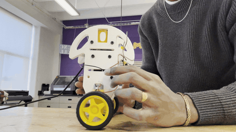
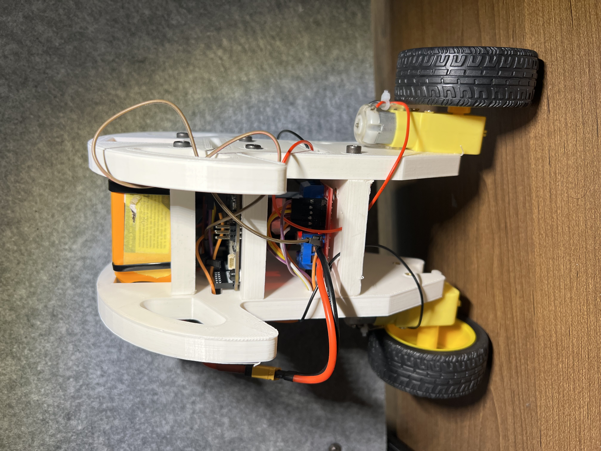
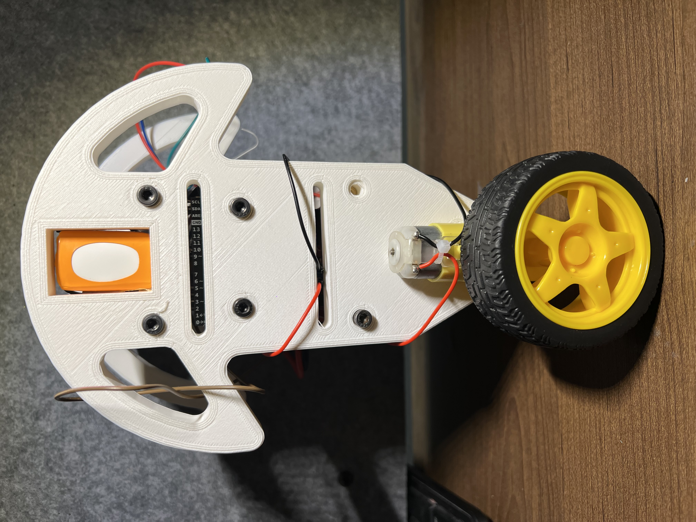
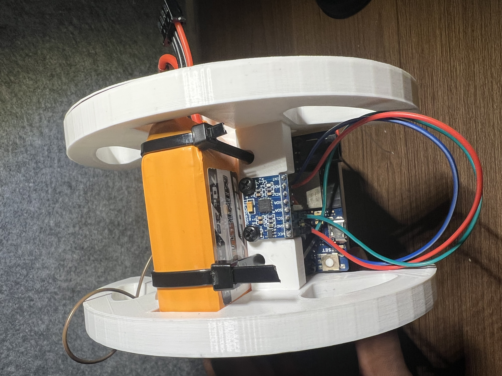
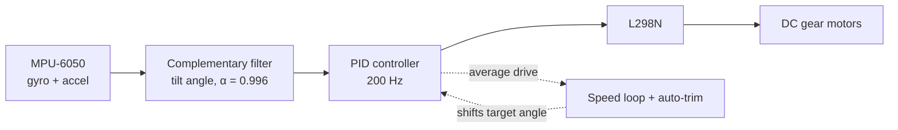

# Self-Balancing Robot

A two-wheeled robot that balances itself upright using an Arduino, an MPU-6050 IMU and a PID controller running at 200 Hz. I designed the chassis in SolidWorks and 3D printed it. The firmware can be tuned live over serial, and its settings are saved between power cycles.

  

  
  
  

**Built by:** Tanush Pilla, Mechanical Engineering, University of Waterloo (Fall 2026)  
**Tools:** SolidWorks, Arduino IDE, 3D printers at WATIMAKE

---

## Contents
- [How it works](#how-it-works)
- [Hardware](#hardware)
- [Wiring](#wiring)
- [Mechanical design](#mechanical-design)
- [Version history](#version-history)
- [What I learned and next steps](#what-i-learned-and-next-steps)

---

## How it works

The robot is an inverted pendulum. When it starts to tip, the wheels drive in the same direction to move back underneath its centre of mass.

1. **Measuring tilt.** The gyroscope reacts quickly but drifts over time. The accelerometer doesn't drift but is noisy, especially on a tall robot where it sits high up and gets shaken whenever the wheels accelerate. A complementary filter blends them, using 99.6% gyro and 0.4% accelerometer. At startup the gyro's offset is calibrated from 600 samples.
2. **PID control.** The difference between the measured angle and the target angle becomes a motor command, recalculated 200 times per second. The derivative term uses the gyro rate directly, which avoids the noise of differentiating the angle.
3. **Stopping drift.** If the balance point is even slightly wrong, the robot stays up by rolling steadily in one direction. Two slow outer loops correct for this:
   - a **speed loop** that tilts the target back against the average drive output
   - an **auto-trim** that slowly shifts the balance point (limited to ±5°)
4. **Safety.** The motors only start once the robot is held within 3° of the target. They cut out if it tips more than 35°.

### Other details
- **Integral anti-windup.** The I term is capped at ±60 PWM and stops accumulating while the output is at its maximum.
- **Motor deadband compensation.** Cheap gear motors don't turn at low PWM, so small commands get a boost. The boost ramps in over the first few PWM units, which stopped the motors from buzzing and slamming back and forth near upright.
- **Left/right motor trim** corrects for mismatched motors.
- **EEPROM storage** keeps tuned settings, including the balance point, after power-off.

---

## Hardware

| Part | Qty | Notes |
|---|---|---|
| Arduino Uno | 1 | Main controller <!-- TODO: R3 or R4? --> |
| MPU-6050 (GY-521 breakout) | 1 | 6-axis IMU over I²C at 400 kHz |
| L298N dual H-bridge | 1 | Motor driver |
| DC gear motor (yellow "TT" type) | 2 | <!-- TODO: gear ratio / RPM, e.g. 1:48 --> |
| 65 mm rubber wheels | 2 | |
| 11.1 V 3S LiPo, 1000 mAh | 1 | XT60 connector |
| 3D-printed chassis | 5 parts | 2 side plates + 3 platforms, <!-- TODO: PLA or PETG --> |
| M3 screws, cable ties, jumper wires | — | |

<!-- TODO: add rough costs if you want a total -->

---

## Wiring

| L298N | Arduino |
|---|---|
| IN1 | Pin 3 |
| IN2 | Pin 2 |
| IN3 | Pin 4 |
| IN4 | Pin 5 |
| ENA (left PWM) | Pin 9 |
| ENB (right PWM) | Pin 10 |

| MPU-6050 | Arduino |
|---|---|
| VCC | 5V |
| GND | GND |
| SDA | SDA |
| SCL | SCL |

**Power:** The LiPo feeds the L298N's 12 V input directly. Arduino is also powered from l298n motor driver 5v power source, or from an external power source via a long USB-C cable.  All grounds are tied together.

---

## Mechanical design

The chassis is a tall, ladder-style frame: two side plates connected by three platforms stacked on top of each other.

| Level | Part | Holds |
|---|---|---|
| Bottom | `Platform_1_L298N` | Motor driver, motor mounts underneath |
| Middle | `Platform_2_Arduino` | Arduino |
| Top | `Platform_3_MPU_LIPO` | LiPo battery and IMU |
| Sides | `Side_Chassis` (×2) | Join the platforms; slots for wiring and access to the Arduino headers |

The battery, the heaviest part, sits at the top on purpose. A higher centre of mass makes the robot fall more slowly, which gives the controller more time to react. The trade-off is that it needs more torque to recover. The IMU is mounted on the top platform so it's level with the chassis.

The SolidWorks part and assembly files are in `cad/solidworks/`, and print-ready STLs are in `cad/stl/`.

<!-- TODO: add print settings (layer height, infill, walls) -->

---

### Default settings

| Setting | Value |
|---|---|
| Kp / Ki / Kd | 21.0 / 250 / 1.2 |
| Speed loop gain | 0.008 |
| Auto-trim rate | 0.0015 |
| Target angle | 3.0° |
| Deadband / max PWM | 30 / 240 |
| Loop rate | 200 Hz |

---

## Version history

Older versions are in `firmware/archive/`. Each one fixed a problem the previous one showed.

| Version | What changed | Why |
|---|---|---|
| v1 | Adafruit MPU6050 library, fixed 3° setpoint, Kp 60 / Ki 30 / Kd 10, minimum PWM of 40 | First attempt. It oscillated violently: the gains were far too high, and every tiny command jumped straight to PWM 40. |
| v2 | Direct I²C register reads; gyro bias and balance point calibrated at startup; adaptive balance point; anti-windup; deadband ramp; Kp 18 / Kd 1.5; max PWM capped at 240 | Stop the shaking and the slow drift to one side. |
| v3 | Live tuning over serial with EEPROM saving; speed loop; motors arm only near upright; filter weighted more heavily toward the gyro | Tall robot: the accelerometer got shaken by the wheels. Re-uploading for every gain change was too slow. |

---

## What I learned and next steps
 - Gained first hand experience with the design, prototype, and iteration process involved in engineering projects
 - Learned to integrate electronic and mechanical components
 - Gained an understanding of PID control systems, their use cases, logic behind their functionality, and actually implementing them in projects
 - If I were to do this again, I would choose a design with a lower center of mass to create a more stable body, and use more accurate sensors to avoid drift 

